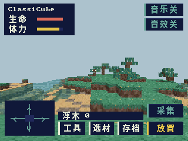

# ClassiCube 实战派 ESP32-S3 移植版

面向立创实战派 ESP32-S3 的 ClassiCube 社区移植，带中文界面和原创离线体素生存玩法。探索河口，采集浮木和芦苇，制作工具，搭起庇护所，并把地图和人物状态保存到 SD 卡。



## 源码来源

**ClassiCube → HoloCubic 的 ESP32-S3 端口 → 本仓库的立创实战派独立固件。**

- [ClassiCube · bb706fd](https://github.com/ClassiCube/ClassiCube/tree/bb706fd05ad6c338e68a17b4f2db45ef3a21663a) 提供游戏引擎与地图系统。
- [HoloCubic 端口 · 883f3a8](https://github.com/clocteck/minecraft-esp32s3/tree/883f3a802a8dd7d1413ffd62d8b9c0b77fb0149b) 提供 ESP32-S3 定点渲染和平台适配，是本仓库的直接上游。
- 本仓库接入实战派的显示、触摸、SD 和音频驱动，加入独立固件、中文界面和原创生存玩法。引擎目录保留了第二层已有的补丁。

[源码目录对应关系与提交号](UPSTREAM.md) · [许可证及署名](THIRD_PARTY.md)

## 当前版本

**v0.1.1 试玩版**。已接入触屏移动和视角、跳跃、长按采集、走近拾取、合成、建造、工具磨损、昼夜、受伤、复活，以及 SD 卡保存和读取。游戏用夜间寒冷、体力消耗和摔落作为主要危险。地图大小为 **96×32×96**，当前是离线单人体验。联网、敌对生物和模式选择不在这一版的功能范围内。

实板已确认进入地图、触摸移动、写入 SD 卡和重启恢复位置。采集、拾取、合成、库存扣除和损坏存档回退也通过了主机检查。实板固定存档视角的日常版日志约 **20–25 FPS**，帧率随视角和地形变化。截图为从设备读取的 LCD 合成帧；发布固件默认关闭自动抓帧。

## 操作与第一夜

| 操作 | 行为 |
| --- | --- |
| 左下方向区 | 按住移动，松手停下 |
| 拖动场景 | 转动视角 |
| BOOT 键 | 跳跃 |
| 采集 | 对准方块后按住，进度完成再走近拾取 |
| 放置 | 放下选中的建材，并扣除存量 |
| 选材 | 切换手里的建材 |
| 工具 | 查看物品、制作配方或食用种荚 |
| 存档 | 写入地图、位置、物品与生存状态 |
| 音乐、音效 | 独立开关，两项每次开机都关闭 |

1. 在出生点附近采集芦苇和浮木，走近掉落物拾取。
2. 打开工具包，用 2 个浮木和 1 个芦苇制作木楔，再去采页岩。
3. 用建材放置顶棚，或制作灯笼。夜间靠庇护或附近的灯避寒。
4. 点“存档”后再关机，下次自动继续。

| 配方 | 材料 |
| --- | --- |
| 木楔 | 浮木 ×2、芦苇 ×1 |
| 页岩锤 | 页岩 ×3、浮木 ×1 |
| 苇格栅 | 芦苇 ×3、页岩 ×1 |
| 树脂灯 | 树脂 ×1、页岩 ×2 |

方块、生存状态与人物位置写入 `/sdcard/siltwalk/maps/silt0.svw` 和 `silt1.svw`。游戏交替写入两份校验存档，优先加载最新的有效版本。游戏运行前请插入 FAT 格式的 SD 卡。默认纹理、音乐和音效已内置，无需手动拷贝资源。

## 适用硬件

实测平台为**立创实战派 ESP32-S3 N16R8**，16 MB Flash、8 MB Octal PSRAM、ST7789 320×240 LCD、FT6336 触摸、ES8311 音频和 SD 卡。场景以 192×144 渲染，再与原生分辨率的中文界面合成。触摸输入每次处理一个触点。

板级连线及调试说明见 [硬件与验证](docs/hardware.md)。

## 从源码构建

安装并启用 [ESP-IDF 6.0.2](https://docs.espressif.com/projects/esp-idf/en/release-v6.0/esp32s3/get-started/index.html) 环境。在仓库根目录执行：

```sh
cd standalone
idf.py -DSILT_CAPTURE_SCREEN=OFF build
idf.py -p COM14 flash
idf.py -p COM14 monitor
```

`COM14` 只是测试机的示例。将其改为设备实际端口。首次编译会从 Espressif 组件仓库下载 `esp_codec_dev`，锁定为 1.6.2。产物是 `standalone/build/siltwalk.bin`。如果已经使用相同的分区表，可使用 `idf.py -p COM14 app-flash` 只更新应用。

也可以下载 [GitHub Releases](https://github.com/ClingYang/siltwalk-esp32s3/releases) 的固件 ZIP。解压后在该目录运行：

```sh
python -m esptool --chip esp32s3 -p COM14 -b 460800 write-flash @flash_args
```

整包烧录写入 0x0 引导程序、0x8000 分区表和 0x10000 应用。固件 ZIP 随附 SHA-256 校验清单。

## 项目与许可

- `standalone/` 包含 ESP-IDF 工程、原创规则、UI、BSP 和资源生成脚本。
- `src/main/` 包含从 HoloCubic 端口沿用的渲染和平台代码。
- `upstream/ClassiCube/` 包含该固件用到的 ClassiCube 源码及第三方依赖。

[构建与实现说明](docs/development.md) · [开源许可与署名](THIRD_PARTY.md) · [GPL v3 许可证](LICENSE)
